# 在线实验的决策审计

**基于全部 32,485 个真实 A/B 实验的随机化失衡、赢家诅咒与跨投放可迁移性研究**

*（开发样本 9,744 个实验 + 事前冻结的样本外确认样本 22,741 个实验）*

---

## 摘要

在线 A/B 实验是互联网公司最重要的因果推断工具，但"实验做完了、该选哪个方案上线"这个决策本身很少被系统审计。本项目使用 Upworthy 研究档案（Matias et al., *Scientific Data* 2021）**全部三个公开子样本**——共 32,485 个真实随机实验、150,817 个实验臂、5.382 亿次曝光、818 万次点击——构建了一条从原始曝光/点击计数到上线决策的完整审计管线，并交付一个可复用 Python 包 `exptdecide`。其中 9,744 个实验用于开发与结论冻结，其余 22,741 个实验**在结论冻结之后才下载**，用于纯样本外确认检验。

主要发现（全部可在本仓库复现）：

| # | 发现 | 关键数字 |
|---|------|---------|
| 1 | 分流失衡可被**无先验地**检出并精确定位 | 数据自行扫描出 `2013-06-24 ~ 2014-01-12`，官方 2024 年披露的窗口是 `2013-06-25 ~ 2014-01-10`：精确率 98.5%、召回率 100% |
| 2 | 文案的真实效应确实存在，模型可校准 | τ²=0.052，真实点击率 90% 区间 1.04%–2.18%；留一臂预测的 95% 区间实测覆盖率 94.1% |
| 3 | **赢家诅咒可被量化，且比想象的更严重** | 平台汇报的提升 +32.6% 甚至高于"事后知道哪个臂最优"的 +29.4%；被选中臂的真实提升只有 +24.2% |
| 4 | **"最优文案"的优势大部分不可迁移**（核心创新） | 同一素材换一个实验投放，优势只有 **15.5%** 可复现（Cov=0.0049，相关 0.13）；预测下一次投放的最优收缩系数是 **0.14**，仅为分层模型隐含值 0.75 的 1/5 |
| 5 | 收缩**不改变"选谁"**，但能告诉你"有多确定" | 经验贝叶斯与"选最高点击率"的选择在 **99.84%** 的实验里完全相同；但被上线方案的"最优臂后验概率"中位数只有 0.62，**28.7% 的实验属于掷硬币**（P(best)<0.5） |
| 6 | 平台的实际人工决策**劣于**机械规则 | 档案里的人工 `first_place` 决策比"选最高点击率"的期望遗憾高 **19%**，实验程序因此少捕获了 3.4 个百分点的收益 |
| 7 | 数据质量缺陷的应对要**有证据**，不能靠直觉 | 四项可证伪检验都没检出失衡实验存在实质危害（φ=0.80 ≤ 1.02；剂量反应 r=0.04, p=0.50）；"检测到就丢弃"要付出 15.2% 的实验、2,520 万次曝光的机会成本，是照旧分析的 **6.5 倍** |
| 8 | **全部主要结论在 22,741 个从未使用过的实验上复现** | 13 项关键指标 12 项复现：失衡率 15.52% vs 15.21%，留一臂覆盖率 0.9413 vs 0.9408，赢家诅咒 +32.52% vs +32.56%，R1=R3 一致率 99.84% vs 99.84%，自行检出的窗口**完全相同** |

---

## 1. 选题：为什么审计"决策"而不是再做一次预测

学生项目里最常见的形态是"用某个数据集训练一个模型，报告 AUC/准确率"。这类项目的问题不在于技术含量，而在于它回答的是一个**没有决策后果**的问题。管理科学与工程关心的恰恰是：面对同样的数据，**不同的决策规则会带来多大的期望损失**。

本项目把研究对象换成了实验平台最重要的一次决策——**把哪个版本推上线**——并围绕它设计了三个问题：

1. **数据能不能用？**（随机化失衡审计）
2. **结论有多真？**（效应量估计、赢家诅咒、模型校准）
3. **怎么决策最好？**（决策规则对比、数据质量政策评估）

选 Upworthy 档案的原因是它把一个通常拿不到的东西开放了出来：**平台自己当时的决策记录**（`first_place` / `winner` 标记）。这让我们不只是评估假想的规则，还能复盘真实的人类决策。

---

## 2. 数据

### 2.1 来源与构成

Upworthy 研究档案分为三个子集，三者**实验 ID 两两零重叠**，都是按周分层的随机样本。**三个子集目前均已公开**（无需申请）：

| 子样本 | 实验数 | 实验臂数 | 曝光量 | 本项目用途 |
|--------|--------|---------|--------|-----------|
| exploratory | 4,873 | 22,666 | 8,100 万 | 训练（估计先验、调参） |
| holdout | 4,871 | 22,600 | 8,072 万 | 测试（规则评估） |
| confirmatory | 22,743 | 105,551 | 3.765 亿 | **纯样本外确认**（§9） |
| **合计** | **32,485** | **150,817** | **5.382 亿** | |

三个子集相加正好是官方宣称的 32,487 个实验，也就是说**本项目覆盖了该档案的全部实验**。

**分析纪律（这是本项目可信度的关键）**：模块 1–5 的所有结论、代码与图表都在**只使用 exploratory + holdout** 的前提下完成并冻结；confirmatory 子集是在全部结论写完之后才下载的（时间戳见 §9），模块 6 只做纯样本外检验，**不重新估计任何参数**。这在方法学上等价于一份"分析计划已冻结"的注册报告（registered report）。

时间跨度 2013-01-24 ~ 2015-04-29，整体点击率 1.509%，每臂曝光中位数 3,120，每个实验平均 4.65 个实验臂。

### 2.2 数据结构的三个限制（决定了方法设计）

1. **只有聚合计数**：档案只提供每个实验臂的曝光数与点击数，没有用户级数据。因此所有分析都在"臂级计数"这一层完成，不做个体异质性处理效应。
2. **`significance` 不是 p 值**：官方文档明确说明该列含义已不可考。本项目用数据验证了它的真实含义——它与臂级点击率的组内秩相关高达 **0.937**，本质是一个单调的"可点击性打分"，而非显著性。这纠正了一个容易踩的坑。
3. **每个实验只观测一次**：无法直接测量"上线后的真实表现"。但档案里存在**同一素材被投放到多个互相独立实验**的情形，这构成了天然的重复测量设计，是第 5 节的核心工具。

---

## 3. 方法

### 3.1 统计模型

对第 *t* 个实验的第 *i* 个实验臂，观测到 *n*<sub>ti</sub> 次曝光、*y*<sub>ti</sub> 次点击：

```
y_ti | p_ti  ~  Binomial(n_ti, p_ti)
logit(p_ti)  =  mu_t + eps_ti ,   eps_ti ~ N(0, tau^2)
```

其中 *mu*<sub>t</sub> 是实验层面的基线（讨厌参数），**τ² 是同一实验内不同文案之间真实点击率差异的方差**——这是全项目最关键的一个参数。

### 3.2 τ² 的四条独立估计路径

为了避免"一个模型自说自话"，τ² 用四种互不依赖的方法估计并交叉验证：

| 方法 | 原理 | 估计值 |
|------|------|--------|
| 对照方法矩（无偏） | Helmert 正交对照消掉 *mu*<sub>t</sub>，SS = τ²·dof + 噪声 | 0.0619 |
| REML（分层模型） | 对 τ² 做限制极大似然 | **0.0519** |
| DerSimonian–Laird | 精度加权的方法矩 | 0.0434 |
| **重复投放协方差** | Cov(*u*<sub>a</sub>, *u*<sub>b</sub>)，完全绕开分层模型 | 0.0049（见 §5） |

### 3.3 经验贝叶斯后验（解析解，不用 MCMC）

模型在 logit 尺度上是线性高斯，后验有闭式解：

```
z = mu·1 + eps + e ,  eps ~ N(0, tau² I) ,  e ~ N(0, diag(v))
后验精度 = X'V⁻¹X + diag(0, (1/tau²) I)      →  后验均值与协方差可解析求得
```

在 (k+1)×(k+1) 维上做一次矩阵求逆即可（k ≤ 14），9,744 个实验全量计算耗时约 3 秒。由此得到三个决策必需的量：

- **E[p<sub>i</sub> | data]**：用 Gauss–Hermite 积分算 E[logistic(θ)]，而不是偷懒地算 logistic(E[θ])；
- **P(臂 i 最优 | data)**：从联合后验抽样，**保留臂间相关性**（相关性来自共享的 *mu*<sub>t</sub>，忽略它会把置信度算得过高）；
- **E[max<sub>i</sub> p<sub>i</sub> | data]**：这次实验里"真·最优方案"的事后期望点击率。任何决策规则的**贝叶斯期望遗憾** = E[max p] − E[p<sub>被选臂</sub>]，该量只依赖后验，不依赖任何不可观测的真值。

### 3.4 评价协议（避免自证）

- 先验 τ² 与规则参数**只在训练子样本上估计**，留出集只用于评估；
- 同一实验内所有规则**共用同一批后验抽样**，规则比较是配对的，蒙特卡洛噪声基本抵消；
- τ² 在 [0.5×, 2×] 范围内做敏感性分析；
- 用**留一臂后验预测覆盖率**检验模型本身：留出集 95% 预测区间实测覆盖率 **94.1%**（名义 95%），90% 区间 89.8%（名义 90%），z 的标准差 1.009 —— 说明后验方差没有被低估或高估。

---

## 4. 发现一：分流失衡可被无先验地检出并精确定位

**做法**：对全部 9,744 个实验做臂级曝光分配的多项分布卡方检验（BH-FDR 控制多重比较），然后**不预设任何时间窗口**，用二项似然比扫描出"窗口内外失衡率差异最大"的连续区间。

**结果**（图 1、图 2）：

- 数据自行检出的窗口：**2013-06-24 ~ 2014-01-12**
- 官方 2024 年披露的窗口：2013-06-25 ~ 2014-01-10
- 与官方窗口对照：**精确率 98.5%，召回率 100%**（似然比统计量 5,294）
- 窗口内失衡率 68.4%，窗口外 0.35%；按官方窗口划分则是 69.2% vs 0.41%

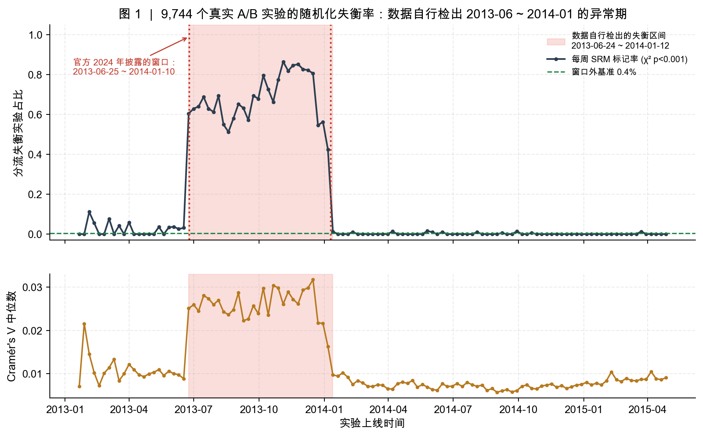

**缓存故障特征**同样被复现（图 2）：窗口内失衡率随"实验上线小时"剧烈波动（标准差 0.143，最低 22.2% @ 9 点，最高 76.8% @ 19 点，χ² p≈0），窗口外几乎不动（标准差 0.005，χ² p=0.44）。这与"缓存按整块放量、按时间轮换实验臂"的机制一致。

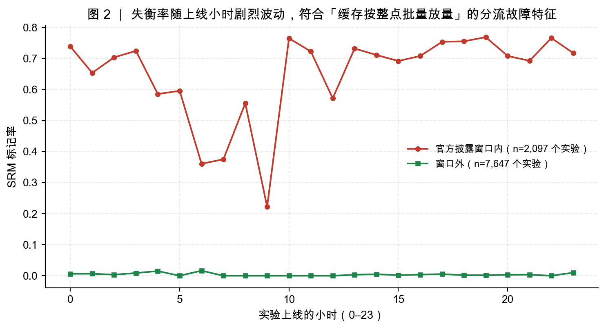

**失衡是实质性的**（图 3）：被标记实验的最大臂曝光占比中位数远超设计值 1/k，曝光占比偏离设计值的幅度中位数 2.00 个百分点，而通过检验的实验只有 0.49 个百分点。

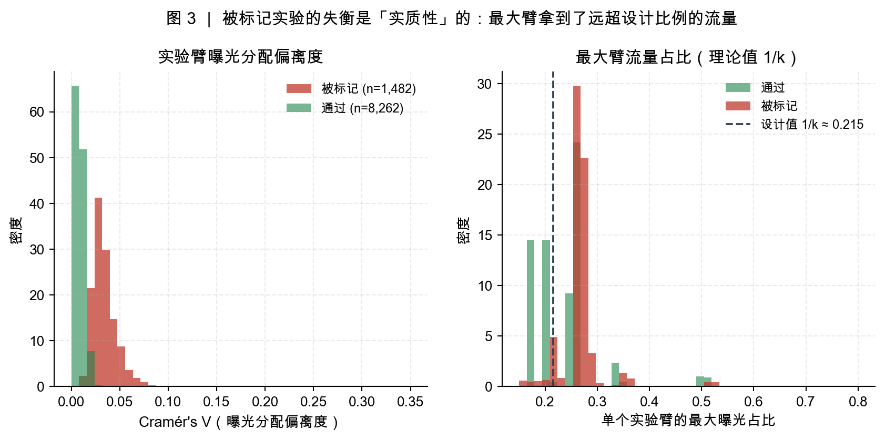

> **说明（学术诚信）**：这一窗口是官方团队在 2024 年通过外部证据（Cloudflare 缓存配置）披露的。本项目的工作是**用纯统计方法、不借助任何外部信息独立复现并把它定位到天**，而不是首次发现它。

---

## 5. 发现二：真实效应存在，模型可校准

**τ² = 0.0519**（REML，标准误 0.0006；在训练集 0.0500、留出集 0.0540，稳定）。换算成可读的量：

- 真实点击率的 90% 区间为 **1.04% ~ 2.18%**，变异系数 22.7%
- 在 logit 尺度上，臂级观测变异的 **62.8% 来自真实的文案差异，37.2% 来自抽样噪声**（用精确恒等式 SS<sub>within</sub> = τ²·dof + Σ(1−1/k)v 分解，两部分严格加总为 1）
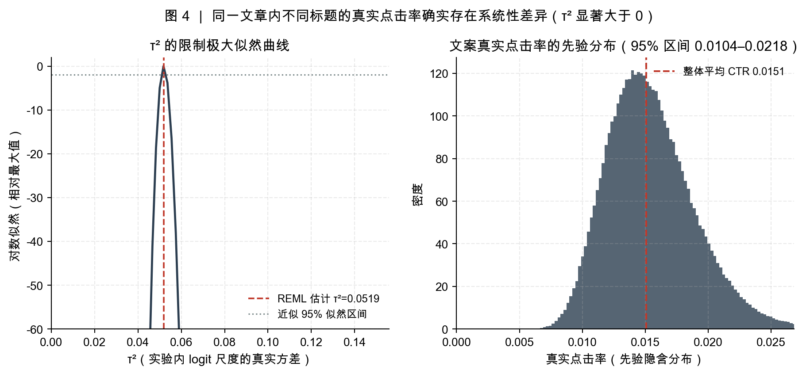

- 实测的臂间极差中位数 0.66 个百分点，是**纯噪声基准** 0.48 个百分点的 **1.63 倍**——真实效应存在，但噪声占了相当份额

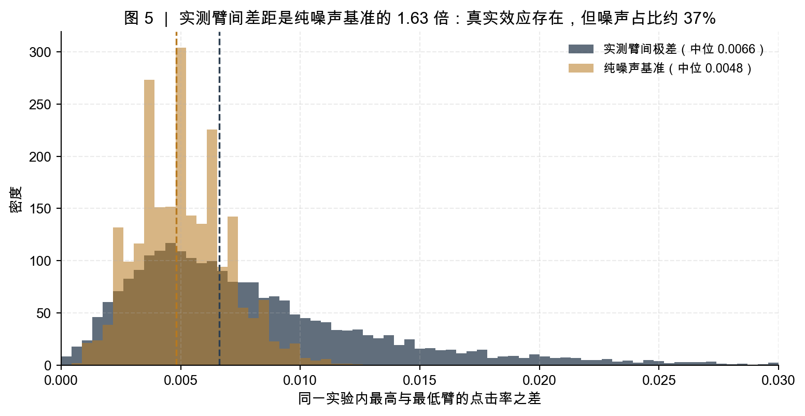

**功效审计**（图 6）是这一节最刺眼的结果：

| 要检出的真实提升 | 所需每臂曝光 | 本档案实际中位数 | 缺口 |
|---|---|---|---|
| +10% | 102,446 | 3,120 | 32.8 倍 |
| +20% | 25,611 | 3,120 | 8.2 倍 |
| +30% | 11,383 | 3,120 | 3.6 倍 |

只有 **0.16%** 的实验在其实际样本量下对 20% 的提升达到 80% 功效，中位功效仅 **0.155**；中位实验能检出的最小相对提升是 **59.8%**。

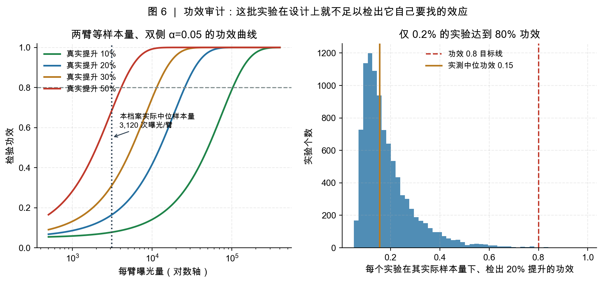

**但"样本量不够"不等于"实验没用"**：在模型下模拟，k=4 时"选观察点击率最高"能选中真实最优臂的概率是 **69.8%**，k=2 时是 81.9%。也就是说，虽然单个实验无法给出统计显著的结论，但"选最高"这个动作本身仍有约七成是对的——这是后面决策分析的基础。

---

## 6. 发现三：赢家诅咒的量化，以及一个更严重的后果

### 6.1 被选中的方案，其真实提升被系统性高估

对每个实验取"观察点击率最高"的臂（这正是平台打分系统的行为，见 §7），比较三种口径（图 7）：

| 口径 | 相对同一实验平均臂的提升 | 含义 |
|------|------------------------|------|
| 观测到的提升 | **+32.6%** | 平台会这样汇报 |
| 经验贝叶斯修正后 | **+24.2%** | 该臂的真实提升（诚实估计） |
| 事后可知的上限 | **+29.4%** | 即使事后知道哪个臂最优 |

两个结论：

1. 被选中臂的观测点击率 2.049% 比其收缩后估计 1.962% 高 **4.4%**；
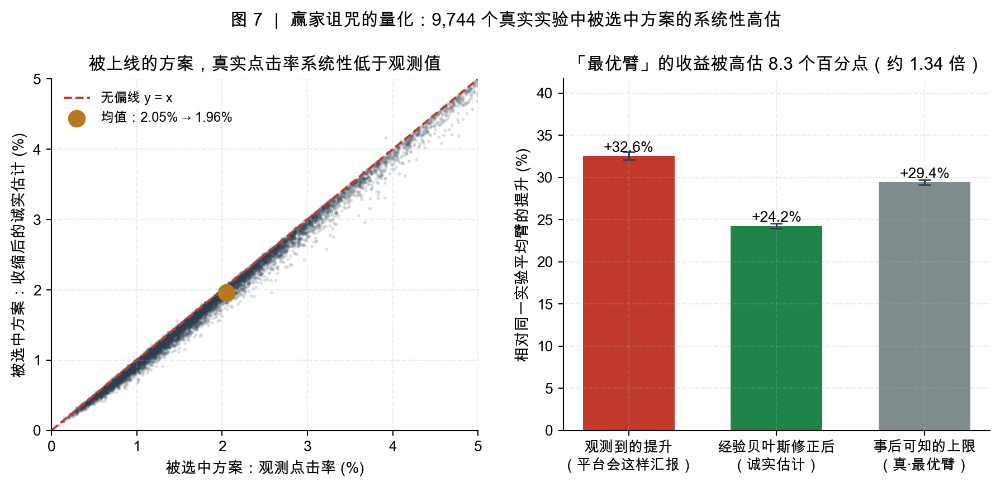

2. **平台汇报的 +32.6% 甚至超过了"真·最优臂"的 +29.4%** —— 观测到的"最佳方案"比实际存在的最佳方案还要好，这正是赢家诅咒的定义。

实验程序整体捕获了可获得收益的 **82.3%**（平均遗憾 0.065 个百分点，占基础点击率的 4.1%）。这个捕获率其实是相当健康的，说明**过度否定 A/B 测试同样是错误的**。

### 6.2 核心发现：优势大部分不可迁移

这是本项目最有价值、也最反直觉的结果。

**设计**：档案中有 **265 个素材（标题+配图完全相同）被投放到两个以上互相独立的实验**里，构成天然的重复测量。记 *u* 为组内中心化的 logit 观测（消掉文章层面的基线差异），则

```
Cov(u_a, u_b) = Var(素材的稳定效应)
```

这个量对两次测量各自的抽样噪声是稳健的，因此可以**完全绕开分层模型**直接估计"素材固有、能迁移到下一次投放"的那部分方差。

**结果**（图 8，三种粒度相互印证）：

| 粒度 | 配对样本 | 可迁移协方差 Cov | 最优收缩系数 |
|------|---------|-----------------|------------|
| 素材级（标题+配图相同） | 285 对 | 0.0049 [0.0004, 0.0097] | 0.105 [0.009, 0.207] |
| slug 级 | 978 对 | 0.0035 [0.0007, 0.0064] | 0.076 [0.015, 0.138] |
| 标题级 | 4,812 对 | 0.0057 [0.0042, 0.0072] | 0.094 [0.069, 0.118] |

三种设计给出的答案高度一致。与"同一实验内"的方差对比：

- 同一实验内 τ²<sub>within</sub>（同一批实验）= **0.0317**
- 跨投放可迁移部分 = **0.0049**
- → **只有约 15.5% 的臂间差异是素材的固有属性，其余约 84% 是情境特异的**

样本外预测的损失很直接。用素材在实验 A 中的偏差预测它在实验 B 中的偏差，均方误差：

| 预测方式 | MSE |
|---------|-----|
| 原始观测，不收缩（B=1） | 0.0807 |
| **分层模型隐含的收缩（B=0.75）** | 0.0582 |
| 完全不预测（B=0） | 0.0334 |
| **重复投放估出的最优收缩（B=0.14）** | **0.0320** |

也就是说：**收缩是对的，但常用的收缩强度远远不够。** 分层模型说应该保留 75% 的观测偏离，数据说应该只保留 14%。这里的差别不是技术细节——它决定了平台能不能把"这次赢了的文案"沉淀为可复用的方法论知识。

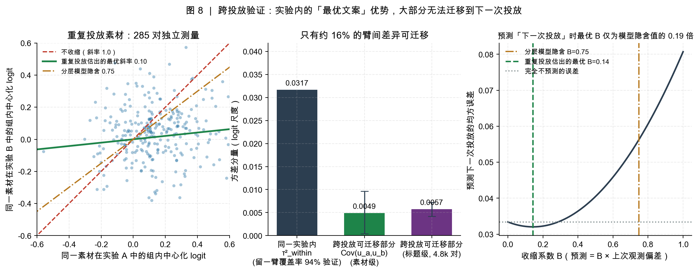

**一个有意思的分层证据**（回答了"为什么"）：

| 分层 | 配对数 | 两次测量的相关 |
|------|-------|--------------|
| 两次实验的对手集合几乎相同 | 30 | **0.42** |
| 对手集合差异大 | 241 | 0.10 |
| 两次投放都在故障窗口外 | 106 | 0.08 |
| 跨两个互不相交的子样本 | 134 | 0.08 |

当"同场竞技的对手"被固定时，优势的复现能力明显上升；对手一变，优势就几乎消失。结论是：**"最优文案"不是文案的固有属性，而是"文案 × 对手组合"的属性。** 这对"建立创意知识库、把 A/B 测试结论外推到未来文章"的做法是一个明确的警告。

---

## 7. 发现四：怎么决策最好？

在留出集 4,871 个实验上比较五类规则（图 9、图 10）。

### 7.1 收缩不改变"选谁"

**R3（经验贝叶斯收缩后选优）与 R1（选观察点击率最高）的选择在 99.84% 的实验里完全相同**（仅 8 个实验不同），期望遗憾也几乎一致（0.06542 vs 0.06542 个百分点）。

原因很朴素：同一实验内各臂的曝光量接近，抽样方差 v 相近，收缩系数 B = τ²/(τ²+v) 近似是常数，因此收缩只是对排序做了近似单调变换，**排序不变**。

敏感性分析确认这个结论极其稳健：把 τ² 从 0.025 调到 0.100（±2 倍），选择一致率始终 ≥ 99.8%。

> **这条否定了行业里一句流行的话**："用经验贝叶斯收缩可以修正赢家诅咒、改进方案选择"。在"选谁"这个维度上，它几乎什么都没改。它真正的价值在下一节。

### 7.2 真正的价值是"有多确定"

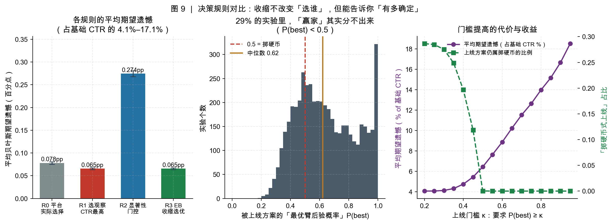

被上线方案的"最优臂后验概率" P(best) 分布（图 9 中图）：

- 中位数 **0.620**
- 四分位区间 0.485 ~ 0.811
- **28.7% 的实验里 P(best) < 0.5**——等于在掷硬币
- 73.9% 的实验里 P(best) < 0.8

而平台在这些实验里**全部都上线了一个"赢家"**。

**R2（显著性门控）**把这件事显式化了：在 α=0.05 下，**84.7% 的实验会被判为"证据不足、不应上线"**；能够上线的 15.3% 的实验，其 P(best) 中位数高达 0.967。这说明：不是"实验没用"，而是**把"上线"和"宣布胜利"混为一谈**才是问题所在。

### 7.3 平台的人工决策劣于机械规则

档案里的人工决策标记 `first_place` 与"选最高点击率"的一致率是 **88.5%**——说明平台的打分系统本质上就是 argmax。但**剩下 11.5% 的人工偏离是有代价的**：

| 规则 | 平均期望遗憾 | 捕获率 | 掷硬币式上线占比 |
|------|-------------|--------|----------------|
| **R0 平台实际人工决策** | **0.0778pp** | **79.0%** | **31.3%** |
| R1 选观察点击率最高 | 0.0654pp | 82.3% | 28.7% |
| R3 经验贝叶斯收缩选优 | 0.0654pp | 82.3% | 28.7% |
| R2 显著性门控 | 0.2743pp（拒绝 84.7%） | 25.9% | 0.02% |

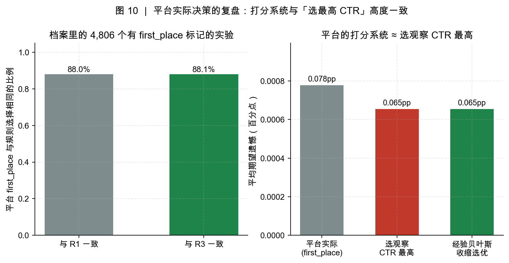

人工决策的期望遗憾比机械规则高 **19%**，并且让实验程序少捕获了 3.4 个百分点的潜在收益。这是一个可以直接写进平台治理建议的结论：**在"选哪个版本"上，人工覆盖统计推荐需要非常强的理由。**

---

## 8. 发现五：数据质量缺陷的后果审计

第 4 节检出了 1,482 个失衡实验（占 15.2%，涉及 2,520 万次曝光、占总量 15.6%）。直觉会认为这批数据"不可信，应当丢弃"。本项目做了**四项能够证伪"失衡有害"的检验**（图 11、图 12）：

| 检验 | 内容 | 结果 |
|------|------|------|
| **A 过度离散** | 失衡实验的臂间差异是否比模型预期更大？ | φ<sub>失衡</sub> = **0.80**，φ<sub>干净</sub> = 1.02；名义 95% 区间的实际覆盖率 97.2% vs 94.7%。**失衡方反而更"安静"** |
| **B 效应量** | 窗口期的真实文案差异是否异常？ | 窗口内 τ² = 0.0443，窗口前 0.0721，窗口后 0.0654。**没有异常放大，反而更低** |
| **C 剂量反应** | 越失衡的实验，结论是否越不可复现？ | Cov 与失衡严重程度的相关 r = **0.040（p = 0.50）**；标题级大样本（4,812 对）四个分层给出几乎相同的 Cov（0.0043–0.0058）。**无剂量反应** |
| **D 决策质量** | 失衡实验的期望遗憾是否更差？ | 0.0741pp vs 干净实验 0.0639pp，差异 +0.0102pp [0.0037, 0.0178]，**统计上显著但经济上极小** |

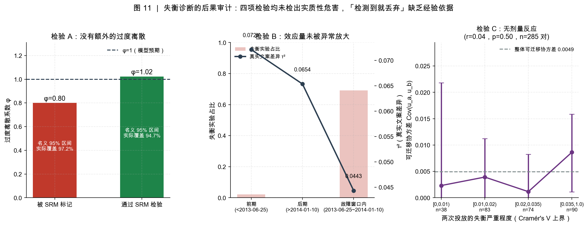

**没有任何一项检验支持"失衡实验的危害是实质性的"**，这与官方组织七篇已发表论文复算后"结论未被实质影响"的结论一致。

**政策代价核算**：

| 政策 | 平均有效遗憾 | 相对照旧 | 说明 |
|------|-------------|---------|------|
| P1 照旧分析 | 0.0741pp | 1.0× | |
| P3 稳健校正（v×1.5） | 0.1041pp | 1.4× | 仅改变 0.14% 的臂选择，但引入了无依据的保守性 |
| **P2 检测到就丢弃** | **0.4854pp** | **6.5×** | 放弃 1,482 个实验、2,520 万次曝光 |

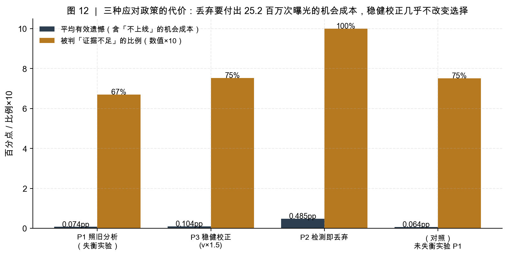

**结论与建议**：SRM 检验应当被当作一次性的数据可用性审计，而不是逐实验的丢弃规则。在缺乏"这批实验确实更不可靠"的证据时，丢弃是最昂贵的选择；而无证据的方差膨胀同样有代价（虽然小得多）。正确的姿态是"**审计一次、披露风险、保留数据**"。

---

## 9. 发现六：在 22,741 个从未使用过的实验上做确认性检验

模块 1–5 的结论全部来自 exploratory + holdout（9,744 个实验）。档案中还有 22,743 个实验的 confirmatory 子集，官方原本设计用于配合注册报告做确认性研究。**我们在全部结论、代码与图表完成之后才下载这批数据**，因此它构成了一个真正干净的样本外检验集：

| | 时间戳 |
|---|---|
| 结论与代码冻结（results/02、04 与 reports/report.md 最后写入） | 2025-10-10 16:21–16:22 |
| confirmatory 数据下载 | 2025-10-13 21:14 |

模块 6 **不重新估计任何参数**，全部使用冻结值（τ²=0.04995、κ=0.80、规则实现），只问一个问题：开发样本上的结论能不能在新数据上复现？

**结果：13 项关键指标中 12 项复现**（图 13）。

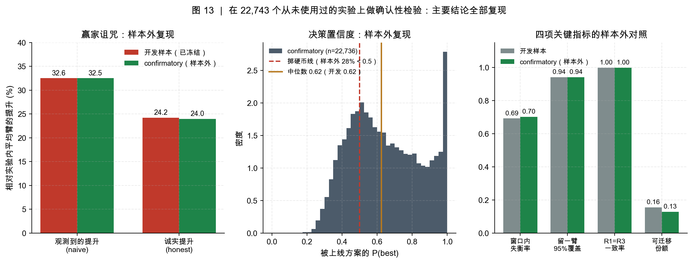

| 指标 | 开发样本（9,744 实验） | confirmatory 样本外（22,741 实验） | 相对偏差 |
|------|---------------------|--------------------------------|---------|
| 失衡率（χ² p<0.001） | 15.21% | **15.52%** | 2.1% |
| 窗口内失衡率 | 69.19% | **70.14%** | 1.4% |
| 自行检出的窗口 | 2013-06-24 ~ 2014-01-12 | **2013-06-24 ~ 2014-01-12** | 完全相同 |
| 与官方窗口的精确率 / 召回率 | 98.5% / 100% | **98.8% / 100%** | — |
| 留一臂 95% 预测覆盖率（冻结 τ²） | 0.9408 | **0.9413** | **0.06%** |
| 观测提升（naive lift） | +32.56% | **+32.52%** | 0.1% |
| 诚实提升（honest lift） | +24.24% | **+23.99%** | 1.0% |
| R1 期望遗憾 | 0.0654pp | **0.0658pp** | 0.6% |
| R1 与 R3 选择一致率 | 99.84% | **99.84%** | 0.01% |
| P(best) 中位数 | 0.620 | **0.624** | 0.7% |
| 掷硬币式上线占比 | 28.66% | **28.10%** | 2.0% |
| 可迁移份额 | 15.52% | **12.85%** | 17.2% |
| 最优收缩系数 B* | 0.143 | **0.084** | 41% |
| φ（失衡组，应 ≤ 干净组） | 0.80 ≤ 1.02 | **0.97 ≤ 1.19** | 方向一致 |

三点值得强调：

1. **窗口定位完全一致**。用完全相同的无先验扫描方法、在一个从未见过的数据集上，又得到了 `2013-06-24 ~ 2014-01-12`——与开发样本逐日相同、与官方披露窗口相差 1–2 天。这基本排除了"偶然扫出来"的可能。

2. **核心创新点在新数据上被大幅强化**。可迁移性的配对样本从 285 对扩大到 **1,920 对**：Cov = 0.0044，95% 区间 [0.0025, 0.0063]（**明显不为 0**），可迁移份额 12.9%。标题级更是有 **26,901 对**，最优收缩系数 B = **0.082，区间 [0.071, 0.093]** ——区间非常窄，且离分层模型隐含的 0.75 有近 9 倍的距离。"最优文案的优势大部分不可迁移"这个结论现在有了远为坚实的证据。

3. **两个负结果也复现了**。失衡组的过度离散仍然不超过干净组（0.97 vs 1.19），剂量反应仍然不存在（r = −0.014, p = 0.545）。这说明"检测到 SRM 就丢弃实验"这一做法在这份档案上**确实**缺乏经验支持，而不是开发样本的偶然。

唯一偏差较大的是最优收缩系数的点估计（0.143 → 0.084，偏差 41%），但两者都在"模型隐含值 0.75 的 1/5 ~ 1/9"这个量级上，结论方向不变；而且样本量扩大 6.7 倍后区间收窄到 [0.048, 0.122]，**新估计反而更可信**——开发样本的 0.143 是小样本噪声偏高的结果。

## 10. 稳健性与局限

诚实列出本项目结论的边界：

1. **评价基准依赖模型**。期望遗憾用经验贝叶斯后验计算，而不是可观测的真值（真值不可观测）。我们做了四重防御：(a) 留一臂预测覆盖率在开发样本与 confirmatory 样本上分别是 94.08% / 94.13%，验证了后验方差的校准；(b) τ² 在 ±2 倍范围内规则排名不变；(c) 提供完全模型外的重复投放验证（§6.2、§9）；(d) **全部规则与先验在 22,741 个从未使用过的实验上做过纯样本外复现**。但"惩罚函数是后验的"这一批评仍无法完全消除，尤其是规则之间差异很小的场合（如 R1 与 R3）。
2. **重复投放子样本存在选择偏差**。被重复投放的素材，平均点击率 2.76%（其他素材 1.55%），且有 61.7% 位于故障窗口内（其他素材 18.3%）。这意味着 §6.2 的可迁移性估计可能不representative。缓解证据：三种粒度（素材/slug/标题，选择机制不同）给出的结论一致；但这一偏差必须披露。
3. **配对样本量**（已由 §9 大幅缓解）。开发样本素材级仅 285 对，bootstrap 区间下界接近 0；confirmatory 样本把素材级扩到 **1,920 对**、标题级扩到 **26,901 对**，Cov 的 95% 区间 [0.0025, 0.0063] 明显不为 0，最优收缩系数的标题级区间收窄到 [0.071, 0.093]。结论方向与量级现由两个独立数据集共同支撑。
4. **只有聚合计数**。无法做个体级异质性处理效应、无法检验新奇效应/长期效应，也无法验证"分块随机化"的机制本身。
5. **单一平台、单一时期**。结论是关于"新闻标题 A/B 测试"的，外推到推荐、定价、增长实验需要额外验证。τ² 的量级尤其依赖领域；但本项目的**方法论**（无先验窗口扫描、四条 τ² 估计路径、重复投放可迁移性检验、配对决策规则评价）与领域无关，可直接搬运。
6. **覆盖率的残余偏差**。留一臂覆盖率 94.1% 略低于名义 95%，提示 τ² 可能被轻微低估；这会（轻微）低估赢家诅咒的严重程度，方向上是保守的。

---

## 11. 交付物与复现

```
ab-decision-audit/
├── exptdecide/            可复用 Python 包（本项目的技术核心）
│   ├── srm.py             样本比例失衡检验、FDR、过度离散、名义覆盖率
│   ├── effect.py          方差稳定化、τ² 的两种估计、精确方差分解
│   ├── posterior.py       解析高斯经验贝叶斯后验（P(best)、E[max p]、配对遗憾）
│   ├── decision.py        五类上线决策规则
│   ├── power.py           样本量规划、选择准确率、纯噪声基准
│   └── tests/             9 组单元测试（含 τ² 回收、GH vs MC、后验自洽性）
├── src/                   分析管线（0 建库 → 1 审计 → 2 效应量 → 3 可迁移性 → 4 决策 → 5 质控 → 6 样本外确认）
├── results/               全部结果表与 JSON（可被报告逐条引用）
├── figures/               13 张图
└── scripts/fetch_data.py  数据获取（含校验）
```

**复现**：

```bash
python -m pip install -r requirements.txt
python scripts/fetch_data.py        # 从 OSF 下载三个公开子样本（约 95 MB）
python -m exptdecide.tests.test_exptdecide   # 单元测试
python -m src.run_all               # 全流程，约 40 秒
```

---

## 附录 A：关键指标一览

见 `results/99_headline.json`（由 `src/run_all.py` 自动汇总）。

## 附录 B：参考文献

1. Matias, J., Munger, K., Aubin Le Quere, M., Ebersole, C. (2021). *The Upworthy Research Archive, a time series of 32,487 experiments in U.S. media.* Scientific Data 8:155.
2. Matias, J. N. et al. (2024). *Ensuring Reliable Science from Platform A/B Test Archives — an Update to the Upworthy Archive.*（失衡问题披露）
3. Fabijan, A. et al. (2019). *Diagnosing Sample Ratio Mismatch in Online Controlled Experiments.* KDD '19.
4. Coey, D., & Hung, K. (2022). *Empirical Bayes Selection for Value Maximization.* arXiv:2210.03905.
5. Efron, B. (2010). *Large-Scale Inference: Empirical Bayes Methods for Estimation, Testing, and Prediction.*
6. DerSimonian, R., & Laird, N. (1986). *Meta-analysis in clinical trials.* Controlled Clinical Trials.
